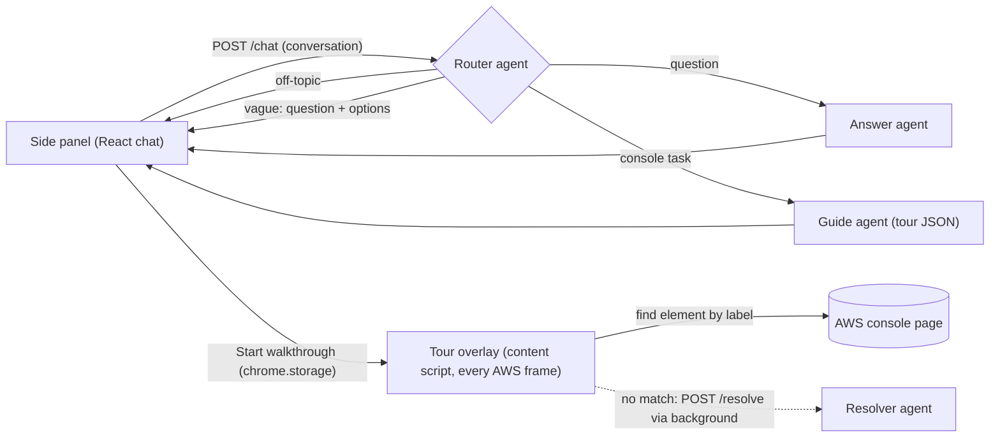

# AWS Chrome Extension with Hugging Face Agent 🚀💡✨

🌟 An AI assistant for the AWS Management Console. Ask a question in Chrome's side panel; when the answer is "do this in the console", it walks you through it like a product tour, highlighting each button or field on the real page with a tip for that step.

## Demo Video


https://github.com/user-attachments/assets/85e7cf9e-5c28-403f-bed2-8722b8ee00ed


## Features 🛠️🤖🚀
- **Chat in the side panel:** stays open while you click around the console, and keeps your conversation.
- **Asks before it guesses:** a vague request like *"I have a Node.js backend, where do I deploy it?"* gets a counter-question with one-click answers (**Serverless (AWS Lambda)** or **Server (Amazon EC2)**), and the walkthrough follows your choice.
- **Guided walkthroughs:** a spotlight and a tip card on each element, with Back/Next and progress. Clicking the highlighted element moves to the next step. Tours survive page navigations and reloads, and work inside iframes and Shadow DOM.
- **Finds the right element:** matches what you see (visible text, ARIA labels, form labels, placeholders, tooltips), ignores hidden copies, tolerates case/plural/wording differences, and prefers the kind of control the step needs. When nothing matches, the AI picks from the elements actually on the page. If the element still isn't there, the card says what it's looking for and lets you search again or skip.
- **Safe by default:** AI output is never injected as HTML into the console, and walkthroughs can only open AWS console URLs.

## How It Works 💡💬✨



1. **Ask:** e.g. "I have a Node.js backend, where should I deploy it?"
2. **Clarify:** pick an option, or type your own answer.
3. **Walk through:** click **Start walkthrough**. The console opens (or the current console tab is used) and each step is highlighted.
4. **Click:** clicking the highlighted element (or filling in the field) moves the tour on.

## Hugging Face Agent 🤖🌐💡
- [AI Agent URL](https://huggingface.co/spaces/Pradipto2002/AWS_Assistant/tree/main), the FastAPI app in [`AWS_Assistant/`](AWS_Assistant)
- **Model:** llama-3.3-70b-versatile on Groq (set `MODEL_NAME` to change it)
- **Endpoints:** `POST /chat`, `POST /resolve`, `GET /` (health)

> **Note:** this version of the extension uses the new `/chat` and `/resolve` endpoints. Redeploy the Space from `AWS_Assistant/` before using it with the hosted backend.

## Installation 🖥️🛠️⚙️
- Chrome 116 or newer
- Node.js 22.12 or newer (to build the extension)
- Python 3.10+ and a [Groq API key](https://console.groq.com/keys) (only to run the backend yourself)

### Setup ⚙️💻📂
1. **Clone and build:**
```bash
git clone https://github.com/ggps2002/AWS-AI-Assistant-Chrome-Extension.git
cd AWS-AI-Assistant-Chrome-Extension
npm install
npm run build
```
2. **Load:** `chrome://extensions/` > `Developer mode` > `Load unpacked` > select the **`dist`** folder
3. **Open:** click the extension's toolbar icon to open the side panel.

### Development 🧑‍💻
- `npm run dev` rebuilds `dist/` on every change. Reload the extension in `chrome://extensions` afterwards, and refresh the AWS tab when you change the content script.
- The UI is React + TypeScript, built with Vite: the side panel in [`src/sidepanel`](src/sidepanel), the walkthrough overlay in [`src/content`](src/content).

### Run the backend locally 🐍
```bash
cd AWS_Assistant
python -m venv .venv && source .venv/bin/activate
pip install -r requirements-dev.txt
echo "GROQ_API_KEY=your-key" > .env
uvicorn main:app --reload --port 7860
```
Then open the side panel's settings (gear icon) and set the backend URL to `http://localhost:7860`.

To deploy, push `AWS_Assistant/` (it is its own git repository) to your Hugging Face Space and add `GROQ_API_KEY` as a Space secret.

## Usage 🚀💬🔑
Open the side panel > ask about AWS > answer any follow-up question > **Start walkthrough** > click the highlighted elements.

If a step's element isn't on the page, the card docks to the corner and tells you what it's looking for. Finish the previous step or go to the right page, or use **Search again** / **Skip step**.

## Tests ✅
```bash
npm test                         # element finder unit tests (Vitest)
npx playwright install chromium  # once
npm run test:e2e                 # builds the extension and runs a full walkthrough in Chromium
cd AWS_Assistant && pytest       # backend tests (no API key needed; the model is faked)
```
The end-to-end test serves mock AWS console pages that mimic the console's tricky markup: nested spans, visually hidden radios, a delayed dropdown, Shadow DOM, an iframe, hidden duplicates, and a button below the fold.

## Structure 🗂️📁📊
```
├── public/              manifest.json and icons, copied into dist/
├── src/
│   ├── background/      service worker: opens the side panel, relays messages, calls /resolve
│   ├── sidepanel/       React chat UI
│   ├── content/         React walkthrough overlay (Shadow DOM)
│   │   └── finder/      finds a step's element on the page
│   └── shared/          types, storage, API client, tour state
├── tests/e2e/           Playwright test and mock console pages
├── AWS_Assistant/       FastAPI backend (Hugging Face Space)
├── scripts/build.mjs    runs both Vite builds
├── vite.config.ts       side panel + background build
└── vite.content.config.ts  content script build (single IIFE)
```

## Contributing 💪💻🌟
1. Fork  
2. Branch (`git checkout -b feature-branch`)  
3. Commit (`git commit -m 'Add feature'`)  
4. Push (`git push origin feature-branch`)  
5. Pull Request  

## License 📜💼✅
Licensed under [MIT License](LICENSE).
